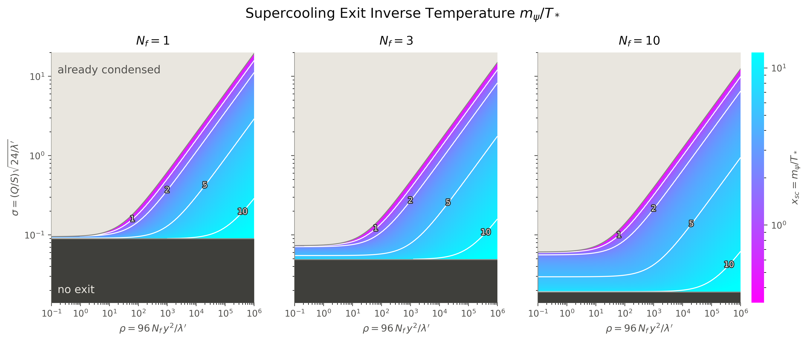

# Supercooling exit from charge supersaturation — code and dataset

[](https://doi.org/10.5281/zenodo.21141438)

This repository accompanies the article *Supercooling exit from charge
supersaturation* by Pietro Baratella, Phys. Rev. D **114**, 063510 (2026),
[doi:10.1103/q5ld-kg6w](https://doi.org/10.1103/q5ld-kg6w)
([arXiv:2512.16601](https://arxiv.org/abs/2512.16601)). It contains:

- **`condensation_threshold.py`**, the interactive script that implements the
  condensation condition of the paper. It is unchanged since version 1.0.0 of
  this repository, the version cited in the article and archived as
  [doi:10.5281/zenodo.21141439](https://doi.org/10.5281/zenodo.21141439).
- **A systematic dataset** over the model's parameter space,
  `data/supercooling_exit.nc`, together with the code that produces it and the
  checks that validate it (added in version 2.0.0).

The code was created with the assistance of Claude (Anthropic).

---

## The problem, for a non-specialist

The early universe can get stuck. A phase transition that ought to happen at
some temperature fails to start, and the universe keeps cooling in the wrong
phase — *supercooling*, the same phenomenon as water staying liquid below 0 °C.
Something has to trigger the transition eventually, or it never completes.

The paper proposes a trigger. A field carrying a conserved charge accumulates
that charge as the universe cools. Its *chemical potential* grows, while the *effective mass* it must
overcome falls as the hot plasma thins out. When the first exceeds the second,
the field condenses and the transition starts. It is the cosmological analogue of
a supersaturated solution crystallising.

This dataset answers, systematically over the model's parameter space, **at what
temperature that happens** — together with the two boundaries outside which it
either happens immediately or never happens.

The physics is confined to
[`src/physics.py`](src/physics.py); the grid design, flagging and validation are
standard practice and are where most of the care went.

---

## The model

The paper studies a 'toy plasma' with the following particle content:

- photons;
- a light neutral scalar $\varphi$;
- a light complex scalar $\phi$, neutral under electromagnetism;
- $N_f$ generations of Dirac fermions $\psi_i$, with mass $m_\psi$ and electric charge 1;
- $N_f$ generations of light Dirac fermions $\chi_i$, with electric charge 1.

On top of the electromagnetic interactions there are the couplings

$$\mathcal{L}_1 = y\,\phi\,\overline\psi_i\chi_i + \text{c.c.}, \qquad \mathcal{L}_2 = \tfrac12\lambda'\,\varphi^2\phi\phi^*.$$

A global $U(1)$ symmetry with generator $Q$ leaves the interactions invariant:
$\phi$ has charge 1, $\psi$ charge 1/2 and $\chi$ charge −1/2.

When the temperature drops to order $m_\psi$, two things happen. In the
presence of a charge asymmetry, the chemical potential $\mu_Q$ grows, because
the charge excess is redistributed into the $\phi$ sector. At the same time the
thermal mass of $\phi$ drops, because $\psi$ decouples. Together they can make
$\phi$ condense, which happens when $\mu_Q > m_\phi^{(\rm th)}$.

### From the condition to $G$

Both sides of $\mu_Q > m_\phi^{(\rm th)}$ are functions of the temperature,
best expressed through $x = m_\psi/T$, which grows as the universe cools:

- **the thermal mass**, $m_\phi^2/T^2 = \lambda'/24 + 4 N_f y^2 I_m(x)$. The
  first term comes from the $\varphi$ loop, the second from the $\psi$ loop, and
  $I_m$ dies off as $\psi$ decouples;
- **the chemical potential**, $\mu_Q/T = (Q/S)\,\hat\mu(x; N_f)$. The charge per
  unit entropy $Q/S$ is conserved as the universe expands; $\hat\mu$, the ratio
  of the entropy to the charge susceptibility of the plasma (Appendix of the
  paper), grows as $\psi$ decouples, because the charge it carried is pushed
  into the $\phi$ sector.

The model therefore has four parameters, $(\lambda', y^2, N_f, Q/S)$, and
condensation requires $(Q/S)\,\hat\mu(x) \ge \sqrt{\lambda'/24 + 4 N_f y^2 I_m(x)}$.
Dividing both sides by $\sqrt{\lambda'/24}$ shows that only three combinations
of them matter:

$$\sigma \;\ge\; G(x;\rho,N_f) \equiv \frac{\sqrt{1+\rho\,I_m(x)}}{\hat\mu(x;N_f)},
\qquad \sigma = \frac{Q}{S}\sqrt{\frac{24}{\lambda'}}, \qquad \rho = \frac{96\,N_f\,y^2}{\lambda'}.$$

$\sigma$ is the reduced charge actually present; $G(x)$ is the reduced charge
the condition requires at temperature $x$. The universe exits supercooling at
the first $x$ where $\sigma$ reaches $G$.

The reduction from four parameters to three is exact, so the scan runs on
`(sigma, rho, N_f)` and stores no redundancy. The mapping both ways is
`physics.to_reduced` / `physics.from_reduced`, and the invariance is a
regression test: parameter sets spanning four orders of magnitude in `lambda'`
give exit points agreeing to `1e-8`.

---

## The three functions

At fixed `(rho, N_f)` the object of interest is the exit point

```
x_sc(sigma) = min { x in [0, X] : G(x; rho, N_f) = sigma }
```

the first temperature at which the condensation condition is met, where
`X = 25` is the end of the scanned range (see "The cutoff in x" below). Three
functions say everything:

| | | |
|---|---|---|
| `sigma_MAX(rho, N_f)` | `= G(0)` | upper edge: at or above it, already condensed |
| `sigma_min(rho, N_f)` | `= min` over `[0,X]` of `G` | lower edge: below it, never |
| `x_sc(sigma, rho, N_f)` | on `[sigma_min, sigma_MAX)` | the exit point |

---

## The dataset at a glance



The figure is an example of what the dataset contains, and a map of the
parameter space at the same time. Each panel is one value of $N_f$; the axes
are the two reduced variables $\rho$ (horizontal) and $\sigma$ (vertical)
defined above, both on logarithmic scales.

- **Colour**: the exit point $x_{sc} = m_\psi/T_*$, the temperature at which
  $\phi$ condenses and the system leaves the supercooled phase; white contours
  at $x_{sc} = 1, 2, 5, 10$.
- **Light region, top**: $\sigma \ge \sigma_{MAX}$. The charge is so large that
  $\phi$ is condensed already at high temperature: there is no supercooling
  phase to exit.
- **Dark region, bottom**: $\sigma < \sigma_{min}$. The condition is never met
  within the domain: no exit.

Every coloured point is obtained from `data/supercooling_exit.nc` alone, by
inverting the stored table as described below.

---

## Quick start

```bash
# use `python -m pip`, not `pip` -- on many systems the two resolve to
# different interpreters and the imports then fail confusingly
python -m pip install numpy scipy xarray netCDF4 matplotlib pytest

python condensation_threshold.py     # the interactive script of the paper (needs matplotlib)
python -m pytest tests/              # 20 checks, ~2 s
python src/dataset.py                # regenerate the dataset, ~10 s
```

---

## How x_sc is stored (why not on a grid in sigma)

`x_sc` is stored as **`G_running_min`**, the running minimum

```
Ghat(x) = min over [0,x] of G
```

tabulated on a grid in `x`. This is the same table read the other way round:
the `x` axis holds x_sc's *values*, and `Ghat` holds the `sigma` at which each
is attained — a non-uniform, column-dependent coordinate, stored as an
auxiliary variable in the usual way.

The reason is resolution. `x_sc` is very unevenly distributed in its own
argument and it has discontinuities near
`sigma_MAX` where it jumps by up to 34× across a `sigma` interval of a few parts
per million. A regular grid in `sigma` fine enough to resolve that would be
enormous, and a coarser one steps over the feature without registering it. A
grid in `x` crosses it with hundreds of points.

Inverting costs one call and gives `x_sc` to a few parts in a million
(median 1×10⁻⁷); right next to a jump, to the grid spacing. `Ghat` is
non-increasing by construction, so the inversion is unambiguous, and its
endpoints are the two edges.

```python
import numpy as np, xarray as xr
ds = xr.open_dataset("data/supercooling_exit.nc")

def x_sc(ds, Nf, j, sigma):
    x, Gh = ds.x.values, ds.G_running_min.values[Nf - 1, j]
    if sigma >= Gh[0]:  return 0.0            # already condensed
    if sigma <  Gh[-1]: return np.nan         # never
    i = max(1, min(int(np.searchsorted(-Gh, -sigma)), len(x) - 1))
    g0, g1 = Gh[i - 1], Gh[i]
    t = (g0 - sigma) / (g0 - g1) if g0 > g1 else 1.0
    return x[i - 1] + t * (x[i] - x[i - 1])
```

`src/grid.py` ships the same thing as `x_sc_from_table`, vectorised.

---

## The cutoff in x

`X = 25` throughout. It corresponds to a `psi` abundance of `e^-25 ≈ 10^-11`.

It is a **declared parameter, not a structural decision**. Whether the
equilibrium description remains meaningful at such abundances is a judgement
about the model. Anyone can
change `X` and regenerate the dataset in under a minute.

What the cutoff costs is recorded per column:

| variable | meaning |
|---|---|
| `x_MAX` | where `sigma_min` is attained |
| `x_MAX_at_cutoff` | 0: `G` turns over inside the domain, so `sigma_min` is a genuine minimum and the eternal-supercooling threshold. 1: `G` is still falling at `X`, so `sigma_min` is merely where the scan stopped |

With `X = 25` the turnover is inside the domain for `N_f ≤ 4` at small `rho` and
beyond it otherwise — `x_MAX` sits near `4.6 N_f + 5`.

---

## Discontinuities of x_sc

`x_sc` is not continuous. Where `G` climbs back above its own running minimum,
`Ghat` is flat: no `sigma` has its first crossing on that stretch, and an
infinitesimal change in charge moves the exit point from one side of it to the
other.

| variable | meaning |
|---|---|
| `n_jumps` | number of interior discontinuities: plateaus of `Ghat` that close before `x_MAX` (the tail beyond `x_MAX` is the domain edge, not a jump) |
| `jump_sigma`, `jump_x_from`, `jump_x_to` | the widest one, measured by `jump_x_to / jump_x_from`: its level, and the exit point just above and just below it |
| `on_plateau` | per cell: 1 where `G` is above its running minimum, so that no `sigma` maps there |

In this dataset `n_jumps` is 0 or 1 everywhere: 12 of the 710 columns have one
jump, all at `N_f = 1` (`rho` from 0.1 to 0.8) or `N_f = 2` (`rho` = 0.1 and
0.13), and none has more. Were there several in a column, `jump_*` would
describe only the widest; all of them remain readable from `on_plateau` and
`G_running_min`.

The jumps are sharp: at `N_f = 1, rho ≈ 0.32` the exit point jumps from
`x = 0.072` to `x = 2.45` across a `sigma` interval of 3 parts per million.

---

## A self-contained approximation

For readers who want the model without the file,
[`src/approx.py`](src/approx.py) is a module depending on **numpy alone** — no
data file, no download, no scipy:

```python
from approx import x_sc, sigma_MAX, sigma_min
x_sc(lam_prime=0.1, y2=0.3, Nf=4, QS=0.006)
```

Below `x = 0.05` it uses the exact small-mass expansion; above it, a Chebyshev
series of degree 32 in a compressed variable, fitted after the Boltzmann tail
`x^a e^-x` is divided out. Relative accuracy of the integrals is `3e-12`,
`7e-12` and `1e-9`; propagated and measured against the full machinery over 300
random parameter points, `x_sc` agrees to **2×10⁻⁸** worst case, `sigma_MAX` to
`1e-15` and `sigma_min` to `1e-8`.

It buys **portability, not precision** — 99 numbers that fit in a paper.
Coefficients are generated by [`tools/make_approx.py`](tools/make_approx.py), so
they are reproducible.

Only `I_m` needed special handling: it is the one integral of the three with a
logarithm at leading order, and a polynomial cannot resolve a branch point. Left
alone its series stalls at `1e-5` while the other two reach `1e-12`; subtracting
the `x^2 log(x)` term analytically before fitting recovers the convergence.

---

## What is in the file

`data/supercooling_exit.nc` — NetCDF4, CF-1.10 conventions, 25 MB.

| layer | variables |
|---|---|
| product | `G_running_min`, `sigma_MAX`, `sigma_min`, `x_MAX`, `x_MAX_at_cutoff`, `n_jumps`, `jump_sigma`, `jump_x_from`, `jump_x_to`, `on_plateau`, `qc_flag` |
| core | `I_S`, `I_Q`, `I_m` — the three thermal integrals |
| reference | `sigma_inf` — the exact asymptote, a landmark |

The core layer is the only genuinely irreducible numerical content: three
functions of one variable, from which everything else is exact algebra.

`qc_flag` follows the QARTOD convention
(1 good, 2 not evaluated, 3 suspect, 4 fail, 9 missing), and is kept separate on purpose
from `on_plateau` and `x_MAX_at_cutoff`.

---

## Quality control

Twenty checks, `python -m pytest tests/`, about 2 s.

Nobody can inspect the dataset cell by cell and judge whether it is right, so
correctness is established by constraints that hold independently of the output
— statements true mathematically, for any parameters, which a code containing a
sign error, a stray factor or a mistyped constant would violate.

**Six exact identities:**

1. the massless limits of the three integrals
2. the small-mass expansion through O(x⁴) — both its value and the `x^6` scaling
   of its residual, which is what establishes that nothing is missing
3. `sigma_inf(N_f) = 15/(pi^2(10+7N_f))` as the exact asymptote, to `1e-16`
4. agreement with an **independent transcription** of the paper's own equations
   by a different algebraic route — 216 parameter combinations, `1e-13`
5. exact homogeneity of degree 1/2 in `(lambda', N_f y^2)`
6. the exact 4D → 3D reduction

Identities 2 and 4 are the strongest, because their reference comes from outside
this package. The expansions are

```
I_S = 7 pi^2/180 - x^2/24       + x^4/(32 pi^2)            + O(x^6)
I_Q = 1/6        - x^2/(4 pi^2) + 7 zeta(3) x^4/(32 pi^4)  + O(x^6)
I_m = 1/24 + x^2/(8 pi^2)[ln(x/pi) + gamma_E - 1/2]
                                - 7 zeta(3) x^4/(128 pi^4) + O(x^6)
```

**The rest** test the product: that `Ghat` is non-increasing, that the two edges
are what they claim, that `x_MAX_at_cutoff` separates a real minimum from the
cutoff in both directions, that inverting the table agrees with a root finder,
that `G'(x_sc) ≤ 0`, that `n_jumps` excludes the domain edge, that straddling
`jump_sigma` really moves `x_sc` across the gap, and that `src/approx.py` agrees
with the rest.

Plus two checks on the numerics and the model: that the splines of the three
integrals reproduce the quadrature to `1e-9`, and that the low-x hump of `G` at
`N_f = 1` — the feature behind the discontinuities — is still there.

---

## Layout

```
condensation_threshold.py  the interactive script of the paper (v1.0.0)
src/thermal_integrals.py   the three thermal integrals
src/physics.py             condensation condition, reduced variables
src/grid.py                the running-minimum scan and its inversion
src/dataset.py             NetCDF assembly and provenance
src/approx.py              self-contained numpy-only approximation
tools/make_approx.py       regenerates approx.py's coefficients
tests/test_identities.py   20 checks
data/                      the dataset
figures/x_sc_panels.png    the figure above
CITATION.cff               citation metadata
LICENSE                    MIT licence for the code
```

## Citation and licence

If you use the code or the dataset, please cite the article,

> P. Baratella, *Supercooling exit from charge supersaturation*,
> Phys. Rev. D **114**, 063510 (2026),
> [doi:10.1103/q5ld-kg6w](https://doi.org/10.1103/q5ld-kg6w),
> [arXiv:2512.16601](https://arxiv.org/abs/2512.16601),

and this archive (GitHub's "Cite this repository" button gives the reference).

The code is released under the MIT licence (see [`LICENSE`](LICENSE)); the
dataset `data/supercooling_exit.nc` under
[CC-BY-4.0](https://creativecommons.org/licenses/by/4.0/).

Pietro Baratella, Jožef Stefan Institute, Ljubljana —
[ORCID 0000-0002-7891-8933](https://orcid.org/0000-0002-7891-8933).
